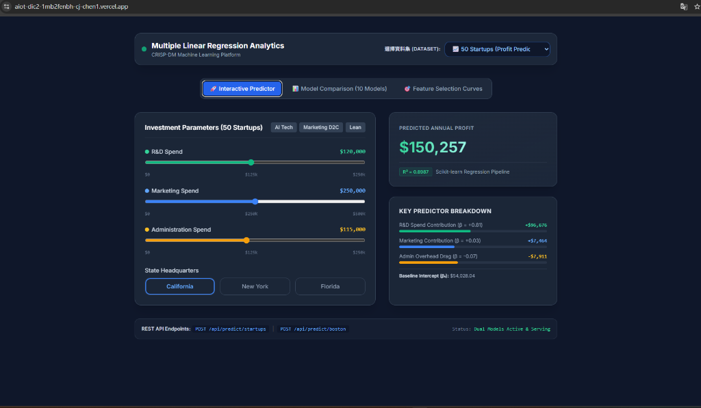
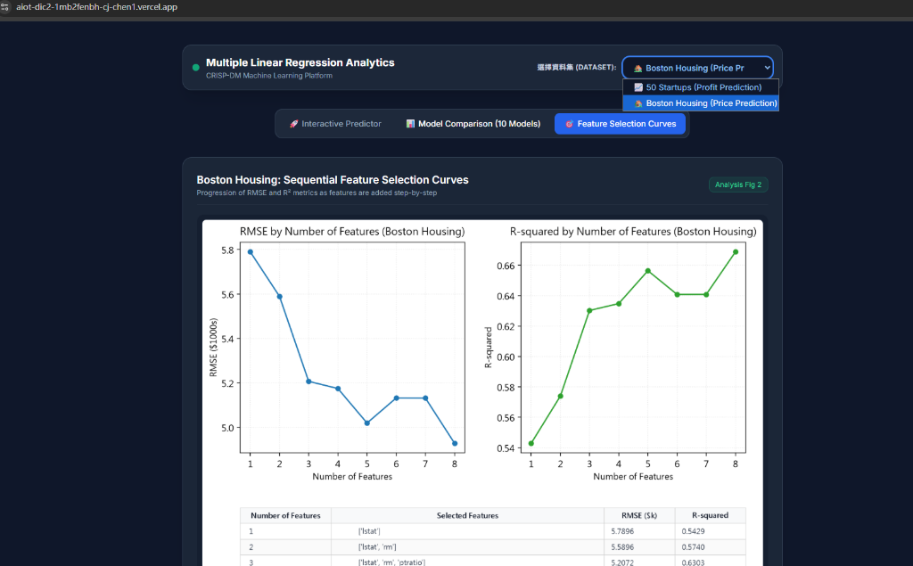
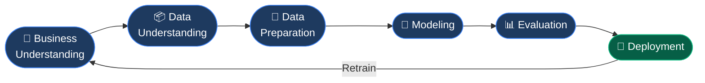

# 📈 Multiple Linear Regression Analytics Engine

> **CRISP-DM Machine Learning Platform** — Dual-dataset regression engine for 50 Startups profit prediction & Boston Housing price prediction, with interactive sliders, 10-model benchmarking, and REST API endpoints.

---

## 🌐 Live Demo

> **Deployed on Vercel:** [https://aiot-dic2-1mb2fenbh-cj-chen1.vercel.app](https://aiot-dic2-1mb2fenbh-cj-chen1.vercel.app)

| 🚀 Interactive Predictor (50 Startups) | 🎯 Feature Selection Curves (Boston Housing) |
|---|---|
|  |  |

---

## ✨ Features

| Feature | Description |
|---|---|
| 🔄 **Dual Dataset Selector** | Switch between 50 Startups and Boston Housing datasets via dropdown |
| 🚀 **Interactive Predictor** | Real-time prediction with sliders and preset scenarios |
| 📊 **10-Model Comparison** | Benchmark of 10 regression models ranked by MSE |
| 🎯 **Feature Selection Curves** | Sequential Forward Selection — RMSE & R² vs. # features |
| 🌐 **REST API** | JSON prediction endpoints for both datasets |
| 🧠 **scikit-learn Pipeline** | `ColumnTransformer` + `LinearRegression` serialized via `joblib` |

---

## 🗂️ Project Structure

```
AIOT_DIC-2_MultipleRegression/
├── app.py                          # Flask web application (main entry)
├── api/
│   └── index.py                    # Vercel serverless function entrypoint
├── train_crisp_dm.py               # Full CRISP-DM training pipeline (50 Startups)
├── train_boston_pipeline.py        # Boston Housing training pipeline
├── generate_analysis_figures.py    # Generate model comparison & feature selection plots
├── predict_startup.py              # Lightweight CLI inference script
├── 50_Startups.csv                 # 50 Startups dataset
├── BostonHousing.csv               # Boston Housing dataset
├── startup_profit_pipeline.joblib  # Serialized 50 Startups pipeline
├── boston_housing_pipeline.joblib  # Serialized Boston Housing pipeline
├── screenshots/
│   ├── demo_startups.png           # Live demo screenshot — Interactive Predictor
│   └── demo_boston.png             # Live demo screenshot — Feature Selection Curves
├── requirements.txt                # Python dependencies
├── vercel.json                     # Vercel deployment configuration
└── public/
    └── figures/                    # Static chart images served by CDN
```

---

## 🔄 Workflow — CRISP-DM Lifecycle



### Phase Details

| Phase | Tools / Steps |
|---|---|
| **1. Business Understanding** | Define prediction target (profit / housing price), set R² goal > 0.85 |
| **2. Data Understanding** | EDA, correlation heatmap, bivariate plots (`eda_analysis.png`) |
| **3. Data Preparation** | `OneHotEncoder` for State, `StandardScaler` for numeric features, `ColumnTransformer` pipeline |
| **4. Modeling** | `LinearRegression`, Ridge, Lasso; 10-model benchmark; Sequential Forward Feature Selection |
| **5. Evaluation** | R², MSE, MAE, residual plots, homoscedasticity checks (`evaluation_diagnostics.png`) |
| **6. Deployment** | Flask app → Vercel Serverless (Python runtime) + GitHub CI/CD |

---

## 🚀 Quickstart

### 1. Install Dependencies

```bash
pip install -r requirements.txt
```

### 2. Train the Pipelines

```bash
# 50 Startups — Full CRISP-DM pipeline
python train_crisp_dm.py

# Boston Housing — Regression pipeline
python train_boston_pipeline.py
```

### 3. Generate Analysis Figures

```bash
python generate_analysis_figures.py
```

### 4. Run the Web Application

```bash
python app.py
```

Open **[http://localhost:5000](http://localhost:5000)** in your browser.

### 5. Predict via CLI

```bash
python predict_startup.py
```

---

## 🌐 REST API Reference

### Health Check

```http
GET /api/health
```

```json
{ "status": "healthy", "models_loaded": { "startups": true, "boston": true }, "version": "2.0.0" }
```

### 50 Startups — Profit Prediction

```http
POST /api/predict/startups
Content-Type: application/json

{
  "rd_spend": 160000,
  "administration": 130000,
  "marketing_spend": 300000,
  "state": "California"
}
```

**Response:**
```json
{
  "status": "success",
  "dataset": "50_startups",
  "predicted_profit": 182943.06
}
```

### Boston Housing — Price Prediction

```http
POST /api/predict/boston
Content-Type: application/json

{
  "rm": 6.8,
  "lstat": 8.5,
  "ptratio": 16.0,
  "dis": 4.2,
  "tax": 350.0
}
```

**Response:**
```json
{
  "status": "success",
  "dataset": "boston_housing",
  "predicted_medv": 29.44,
  "predicted_value_usd": 29435.26
}
```

---

## 📦 Tech Stack

| Layer | Technology |
|---|---|
| **Backend** | Python 3, Flask |
| **ML Framework** | scikit-learn (`Pipeline`, `ColumnTransformer`, `LinearRegression`) |
| **Data Processing** | pandas, NumPy |
| **Serialization** | joblib |
| **Frontend** | Tailwind CSS, Vanilla JavaScript |
| **Deployment** | Vercel (Python Serverless Runtime) |
| **Version Control** | GitHub |

---

## 📊 Model Performance

| Dataset | Model | R² | RMSE |
|---|---|---|---|
| 50 Startups | Multiple Linear Regression | **0.8987** | ~$9,003 |
| Boston Housing | Multiple Linear Regression | **0.67** | ~$5.02k |

---

## 📁 Datasets

| Dataset | Rows | Features | Target |
|---|---|---|---|
| `50_Startups.csv` | 50 | R&D Spend, Administration, Marketing Spend, State | **Profit** |
| `BostonHousing.csv` | 506 | CRIM, ZN, INDUS, CHAS, NOX, RM, AGE, DIS, RAD, TAX, PTRATIO, B, LSTAT | **MEDV** (median house value ×$1,000) |
